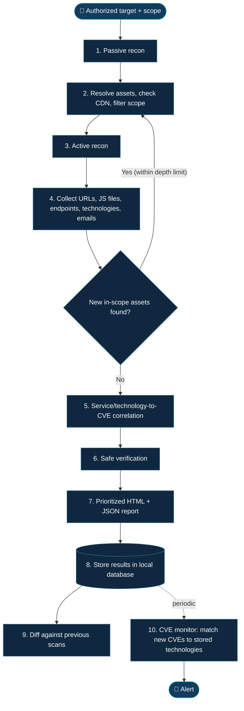

<div align="center">


### An authorization-first reconnaissance, vulnerability-correlation and CVE-monitoring command-line tool

*Discover the surface. Prioritize the evidence. See what changed.*

</div>

---


## ⚡ Overview

**Marsadix** is an open-source command-line tool that brings reconnaissance, service discovery, vulnerability correlation, safe verification, scan comparison and CVE monitoring into one workflow.

You give it an **authorized domain**. It collects everything related to that domain (subdomains, IPs, services, technologies, URLs, JavaScript files, endpoints and public emails), feeds what it finds back into the process (recursive recon) while staying inside the authorized scope, correlates detected services and technologies with known CVEs, assigns a **confidence level** to every finding, confirms findings with **non-destructive checks only**, and produces a consolidated report.

Everything is stored, so later scans can be **compared** to show what changed, and newly published CVEs can be **matched against the technologies you have already discovered**, with an alert when one applies.

Marsadix deliberately **stops at verification**. Exploitation and impact analysis remain the tester's job.

## 🧩 The problem

Security assessments usually mean running several tools and manually stitching their results together.

- 🔎 Raw output is noisy and hard to prioritize.
- 🧩 Service, technology and version data end up scattered across tools and files.
- ⚠️ Matching a version to a CVE alone produces false positives (for example, distribution backports).
- 🔁 Many workflows run once and stop, instead of feeding discoveries back into further recon.
- 🕰️ Changes between scans, and newly published CVEs for already-known technologies, are easy to miss.
- 🛡️ Scope and CDN safety need deliberate attention, especially when recon expands recursively.

**Marsadix aims to connect the dots**, with evidence, confidence levels and scope safety built into the workflow.

## ✨ Core capabilities

| 🕵️ **Recursive reconnaissance** Passive and active discovery that feeds new findings back into the process, within scope and a depth limit. | 🗂️ **Broad collection** Subdomains, IPs, ports, services, technologies, URLs, JavaScript files, endpoints and public emails. |
| --- | --- |
| 🧠 **CVE correlation** Connect detected service and technology evidence with known vulnerabilities. | 📊 **Confidence scoring** Separate possible, likely and confirmed findings based on evidence. |
| 🛡️ **Safe verification** Validate findings with non-destructive checks, without exploitation. | 🔁 **Scan diffing** Compare scan history to identify new assets, ports, technologies and findings. |
| 🔔 **CVE monitor** Match newly published CVEs against stored technologies and send alerts. | 📄 **Unified reports** Prioritized HTML report plus machine-readable JSON. |

## 🔬 How it works



### What gets collected

| Category | Examples |
| --- | --- |
| Assets | Subdomains, DNS records, resolved IPs, ASN / network owner, CDN detection |
| Services | Open ports, service names and versions, banners |
| Technologies | Web servers, frameworks, CMS, JavaScript libraries and their versions where detectable |
| Web surface | URLs (including archived ones), JavaScript files, endpoints and parameters found in JS and crawling |
| People data | Public email addresses (public sources only, see the privacy note below) |

### Recursive recon, safely

Every new asset discovered (a subdomain mentioned in a JavaScript file, a new host behind a redirect) goes back through the pipeline, but only after it passes the scope check. Recursion is bounded by a configurable **depth limit** and **de-duplication**, so the process ends and does not wander into third-party infrastructure such as CDNs, analytics or other external services referenced by the target.

## 🎚️ Finding confidence

A version match alone does **not** prove a target is vulnerable. The confidence model makes the available evidence explicit.

| Evidence | Confidence | Meaning |
| --- | --- | --- |
| Version match only | 🟡 **Possible · Low** | Potential match; needs more evidence |
| Template or banner-specific match | 🟠 **Likely · Medium** | Stronger indication, but not definitive |
| Safe check demonstrates the issue | 🟢 **Confirmed · High** | Supported by non-destructive verification |

Distribution backports, inaccurate banners and other version-matching pitfalls must be taken into account.

## 🔔 CVE monitor

Reconnaissance is usually a one-time snapshot, but new vulnerabilities are published every day. The CVE monitor turns the technology inventory into a watch list.

1. During scans, Marsadix stores each asset with its detected technology, version (when available) and confidence.
2. A periodic job fetches newly published or updated CVEs from public sources such as the **NVD API** and **CISA KEV** (and optionally other advisory databases).
3. New CVEs are matched against the stored technologies (CPE matching).
4. When a match is found, an alert is sent through a configured channel (planned: Telegram, Discord, email or webhook).

Alerts carry the **confidence level** of the match and a priority based on severity and known-exploitation status, so a technology detected without an exact version does not create the same urgency as a confirmed version match.

> **Limitations to keep in mind:** newly published CVEs sometimes appear in NVD before their product (CPE) data is complete, so matching can lag. An NVD API key is recommended to avoid rate limits.

## 🔁 Scan diffing

Each scan is stored, and Marsadix compares it with previous ones to answer: *what is new, what disappeared, and what changed?* Examples include new subdomains, newly opened ports, changed technologies and versions, and newly detected findings. This turns a one-off scan into continuous attack-surface monitoring.

## 🛡️ Safety-first by design

- **Scope filtering:** targets and every newly discovered asset are validated against the authorized scope before active scanning.
- **CDN and shared-hosting awareness:** a CDN or hosting provider's IP is never treated as permission to scan unrelated assets, and ASN ownership is checked rather than assumed.
- **Verify-only approach:** no exploitation is performed by the tool.
- **Safe mode:** a planned `--safe-mode` option prevents any check that could affect the target.
- **Configurable rates:** request rates are adjustable to reduce load on target systems.
- **Evidence-driven output:** uncertainty is communicated instead of treating every match as confirmed.
- **Privacy:** email addresses are personal data. Collect them from public sources only, store the minimum needed, and do not publish them in reports or repositories.

> Only test systems you own or have explicit permission to assess. Follow the target's rules of engagement and bug bounty scope.

## 💻 Planned command-line interface

Marsadix is a command-line tool, designed to run in terminals, scripts and automation pipelines.

> The commands below are an **illustrative design draft** and are not implemented yet. Names and options may change.

```bash
# Run a scope-checked scan on an authorized domain
marsadix scan example.com --scope scope.txt --safe-mode

# Compare the latest scan with the previous one
marsadix diff example.com

# Check new CVEs against stored technologies and send alerts
marsadix monitor
```

## 🧰 Planned technology stack

These are candidate building blocks from the project plan; integrations may change after evaluation.

| Purpose | Candidate tools / sources |
| --- | --- |
| Passive discovery | [Subfinder](https://github.com/projectdiscovery/subfinder), [OWASP Amass](https://github.com/owasp-amass/amass), [crt.sh](https://crt.sh/), [Wayback Machine](https://web.archive.org/) |
| DNS / resolution | [dnsx](https://github.com/projectdiscovery/dnsx), CDN detection, ASN ownership lookup |
| Ports / services | [Naabu](https://github.com/projectdiscovery/naabu), [Nmap](https://nmap.org/), [httpx](https://github.com/projectdiscovery/httpx) |
| URLs / JS / endpoints | [katana](https://github.com/projectdiscovery/katana), [gau](https://github.com/lc/gau), JavaScript endpoint extractors such as [jsluice](https://github.com/BishopFox/jsluice) or LinkFinder |
| Technology detection | httpx technology detection, Wappalyzer-style rules, [retire.js](https://retirejs.github.io/retire.js/) data for JavaScript libraries |
| Emails (public sources) | [theHarvester](https://github.com/laramies/theHarvester) or similar OSINT sources |
| Web verification | [Nuclei](https://github.com/projectdiscovery/nuclei) |
| CVE data | [NVD](https://nvd.nist.gov/), [CISA KEV](https://www.cisa.gov/known-exploited-vulnerabilities-catalog), CPE matching, SearchSploit database |
| Optional network scanner | [OpenVAS / Greenbone](https://www.greenbone.net/) |
| Storage / reporting | Python, Jinja2, SQLite and/or JSON |
| Packaging | Docker |

## 📈 Reports

The intended output helps answer:

- What assets, technologies and services were discovered?
- Which findings have the strongest evidence?
- What deserves attention first?
- Which results are possible matches versus safely confirmed issues?
- What changed since the previous scan?

**Planned outputs:** a readable, filterable HTML report, structured JSON results, scan-to-scan differences and CVE alerts.

## 🔎 Related projects

Marsadix builds on ideas from, and is meant to be compared against, existing reconnaissance and scanning projects, including [FinalRecon](https://github.com/thewhiteh4t/FinalRecon), [reconFTW](https://github.com/six2dez/reconftw), [BBOT](https://github.com/blacklanternsecurity/bbot), [Osmedeus](https://github.com/j3ssie/osmedeus), [driftmux](https://pypi.org/project/driftmux/) and [ScopeSentry](https://github.com/Autumn-27/ScopeSentry). Several of them already cover parts of this workflow, and reusing their strengths is part of the plan.

The differences this project aims for are the combination of recursive recon with enforced scope safety, confidence-scored correlation with verify-only checks, scan-to-scan diffing, and a CVE monitor built on the discovered technology inventory. Any claim about another tool's limitations will be published only after it has been reproduced and documented in the benchmarks.

## 🗺️ Roadmap

### MVP

- [ ] Passive and active reconnaissance
- [ ] Recursive recon with scope enforcement and depth limit
- [ ] CDN detection and scope filtering
- [ ] Collection of URLs, JavaScript files, endpoints, technologies and public emails
- [ ] Local database storing assets, technologies and scan history
- [ ] Service/technology-to-CVE correlation and confidence levels
- [ ] Web checks using Nuclei and safe verification mode
- [ ] HTML and JSON reporting
- [ ] Scan-to-scan diffing
- [ ] CVE monitor with alerts (NVD and CISA KEV, one alert channel)
- [ ] Docker packaging
- [ ] Reproducible benchmarks

### Stretch goals

- [ ] OpenVAS integration through GMP
- [ ] Import `.nessus` exports
- [ ] Deeper network assessment module
- [ ] Scheduled scans
- [ ] Additional alert channels

## 🧪 Testing & evaluation

Planned testing environments include:

- Local labs such as [OWASP Juice Shop](https://github.com/juice-shop/juice-shop) and [DVWA](https://github.com/digininja/DVWA).
- Personal lab infrastructure.
- Public test targets only within their published usage limits.
- Bug bounty assets that are explicitly in scope.

The project plan includes benchmarking selected existing tools on the same authorized targets (time, number of findings, accuracy and false positives).

## 🚀 Getting started

Installation and run instructions will be added when the implementation and supported environment are established.

The first runnable release should document prerequisites, installation, authorized-scope configuration, safe scan commands, and the location of HTML, JSON and diff outputs.

## 🤝 Contributing

Potential contribution areas include:

- Scope validation, CDN safety and recursion limits.
- Service and technology fingerprinting, and CVE correlation.
- Confidence scoring and false-positive reduction.
- Safe verification checks.
- Reporting, scan-diff accuracy and CVE-monitor matching.
- Reproducible benchmarks and documentation.

For substantial changes, open an issue first to discuss the approach. Any reused upstream code must retain its license notices and attribution requirements.

## ⚖️ Responsible use

Marsadix is intended to support defensive security work, authorized penetration testing and attack-surface monitoring. The operator is responsible for confirming authorization, respecting scope, setting safe request rates and complying with applicable laws and program rules.

The project is not intended to exploit vulnerabilities or access data without permission.

## 🛰️ Why "Marsadix"?

**Marsadix** takes inspiration from the Arabic word **مرصد (marsad)**, an observatory or monitoring post, combined with a technical suffix. It reflects the project's central idea: continuously observe an attack surface and notice what changes.

---

<div align="center">

**Recon smarter. Verify safely. Track every change.**

Open-source security tooling · Scope-aware by design · Evidence-driven assessments

</div>
